# 🏥 Pharmacy Management System

> A modern Laravel-based Pharmacy Management System developed to automate pharmacy operations including inventory management, medicine sales, purchases, supplier management, reporting, and user administration.

<p align="center">


</p>

---

# 📑 Table of Contents

- [Project Overview](#project-overview)
- [Problem Statement](#problem-statement)
- [Objectives](#objectives)
- [Key Features](#key-features)
- [Technology Stack](#technology-stack)
- [System Architecture](#system-architecture)
- [Project Structure](#project-structure)
- [MVC Workflow](#mvc-workflow)
- [Database Design](#database-design)
- [Entity Relationship Diagram](#entity-relationship-diagram)
- [Class Diagram](#class-diagram)
- [Use Case Diagram](#use-case-diagram)
- [Component Diagram](#component-diagram)
- [Sequence Diagrams](#sequence-diagrams)
- [Activity Diagrams](#activity-diagrams)
- [Flow Diagrams](#flow-diagrams)
- [Module Documentation](#module-documentation)
- [API Documentation](#api-documentation)
- [Security Features](#security-features)
- [Installation Guide](#installation-guide)
- [Configuration](#configuration)
- [Running the Project](#running-the-project)
- [Testing](#testing)
- [Deployment](#deployment)
- [Future Scope](#future-scope)
- [Contributing](#contributing)
- [License](#license)
- [Authors](#authors)

---

# 📖 Project Overview

The Pharmacy Management System is a web-based enterprise application built using the Laravel Framework.

The primary objective of this system is to digitalize pharmacy operations by replacing manual inventory and billing systems with an integrated software solution.

The system enables pharmacy administrators to manage medicines, suppliers, purchases, inventory, users, and sales from a centralized dashboard.

Different users have different access privileges according to their assigned roles, ensuring security and proper workflow management.

The application follows Laravel's MVC architecture, making it modular, scalable, secure, and maintainable.

---

# ❗ Problem Statement

Traditional pharmacy management often depends on handwritten records and spreadsheets.

This creates several operational problems including:

- Incorrect stock information
- Medicine expiration losses
- Slow billing process
- Difficulty generating reports
- Human calculation errors
- Poor supplier management
- Lack of centralized data
- Security vulnerabilities due to manual record keeping

To overcome these issues, this Pharmacy Management System provides an automated digital solution.

---

# 🎯 Objectives

## Primary Objectives

- Maintain medicine inventory accurately
- Track medicine batches and expiry dates
- Automate billing process
- Manage supplier information
- Generate invoices automatically
- Produce business reports
- Maintain purchase history
- Reduce manual work

## Technical Objectives

- Follow Laravel MVC architecture
- Use MySQL relational database
- Responsive Bootstrap interface
- Role Based Access Control
- Secure authentication
- Input validation
- Optimized database queries
- Maintainable source code

---

# ✨ Key Features

## 🔐 Authentication

- Login
- Logout
- Password Encryption
- Role Based Authentication
- Session Management
- Remember Me
- User Authorization

---

## 👤 User Management

- Admin Management
- Manager Management
- Cashier Management
- Profile Management
- Role Assignment

---

## 💊 Medicine Management

- Add Medicine
- Update Medicine
- Delete Medicine
- Medicine Categories
- Manufacturer Information
- Generic Name
- Barcode Support
- Search Medicines
- Medicine Filtering

---

## 📦 Inventory Management

- Real-Time Stock Monitoring
- Batch Management
- Stock Adjustment
- Low Stock Alert
- Expiry Alert
- Inventory Movement History

---

## 🏪 Supplier Management

- Supplier Registration
- Supplier Profile
- Purchase History
- Contact Information

---

## 🛒 Purchase Management

- Purchase Orders
- Purchase Invoice
- Purchase History
- Purchase Details
- Inventory Update
- Supplier Selection

---

## 💰 Sales Management

- POS Billing
- Invoice Generation
- Discount Calculation
- Tax Calculation
- Payment Processing
- Invoice Printing
- Sales History

---

## 📊 Reporting

- Daily Sales
- Monthly Sales
- Purchase Reports
- Inventory Reports
- Low Stock Report
- Expired Medicine Report
- Financial Summary

---

## ⚙️ Settings

- Pharmacy Information
- Tax Configuration
- Currency Settings
- User Preferences

---

# 🛠 Technology Stack

| Layer | Technology |
|--------|------------|
| Backend | Laravel 11 |
| Programming Language | PHP 8.2 |
| Database | MySQL |
| Frontend | Blade |
| CSS Framework | Bootstrap 5 |
| JavaScript | JavaScript, jQuery |
| Build Tool | Vite |
| ORM | Eloquent ORM |
| Authentication | Laravel Authentication |
| Version Control | Git |
| Package Manager | Composer |
| Dependency Manager | NPM |

---

# 🏗 System Architecture

The project follows Laravel's MVC (Model View Controller) architecture.

```
                User
                  │
                  ▼
          Web Browser
                  │
                  ▼
          Laravel Routes
                  │
                  ▼
            Controllers
                  │
      ┌───────────┴───────────┐
      ▼                       ▼
   Models                 Blade Views
      │
      ▼
 MySQL Database
```

### Main Components

- Authentication Module
- User Management Module
- Medicine Module
- Supplier Module
- Purchase Module
- Sales Module
- Inventory Module
- Reporting Module
- Settings Module

---

# 📂 Project Structure

```
Pharmacy_Management/
│
├── app/
│   ├── Http/
│   │    ├── Controllers/
│   │    ├── Middleware/
│   │    └── Requests/
│   │
│   ├── Models/
│   │
│   ├── Providers/
│   │
│   └── Services/
│
├── bootstrap/
│
├── config/
│
├── database/
│   ├── migrations/
│   ├── factories/
│   └── seeders/
│
├── public/
│
├── resources/
│   ├── css/
│   ├── js/
│   ├── images/
│   └── views/
│
├── routes/
│   ├── web.php
│   └── api.php
│
├── storage/
│
├── tests/
│
├── vendor/
│
├── artisan
│
├── composer.json
│
├── package.json
│
├── vite.config.js
│
└── README.md
```

---

# 🔄 MVC Workflow

```
User Request
      │
      ▼
Laravel Route
      │
      ▼
Controller
      │
      ▼
Business Logic
      │
      ▼
Model
      │
      ▼
Database
      │
      ▼
Controller
      │
      ▼
Blade View
      │
      ▼
Browser Response
```

---

# 📊 Database Design

The application uses a relational MySQL database.

The major entities include:

- Users
- Medicines
- Medicine Types
- Suppliers
- Purchases
- Purchase Items
- Sales
- Sale Items
- Inventory Batches
- Stock Movements
- Pharmacy Returns

These entities are connected through foreign key relationships to ensure data integrity and normalization.

---

# 🗄 Database Design

## Overview

The Pharmacy Management System uses **MySQL** as its primary relational database management system. The database has been designed following normalization principles to minimize redundancy while maintaining high performance and data integrity.

Laravel's **Eloquent ORM** is used for object-relational mapping, allowing seamless interaction between PHP models and database tables.

### Database Characteristics

- Relational Database
- MySQL 8.0+
- ACID Compliant
- Foreign Key Constraints
- Normalized Schema (up to 3NF)
- Auto Increment Primary Keys
- Timestamp Management
- Soft Delete Support (where applicable)

---

# 🏛 Database Architecture

The database is divided into several functional modules.

```
                    USERS
                      │
      ┌───────────────┼──────────────┐
      │               │              │
      ▼               ▼              ▼
 PURCHASES        SALES      STOCK MOVEMENTS
      │               │              │
      ▼               ▼              ▼
PURCHASE ITEMS   SALE ITEMS    INVENTORY
      │               │
      └───────┬───────┘
              ▼
         MEDICINES
              │
      ┌───────┴────────┐
      ▼                ▼
MEDICINE TYPES   INVENTORY BATCHES
              ▲
              │
        PHARMACY RETURNS

SUPPLIERS
     │
     ▼
PURCHASES
```

---

# 📋 Database Tables

| Table | Purpose |
|--------|----------|
| users | Stores application users |
| medicine_types | Medicine categories |
| medicines | Medicine information |
| suppliers | Supplier information |
| purchases | Purchase transactions |
| purchase_items | Purchase details |
| sales | Sales invoices |
| sale_items | Sold medicines |
| inventory_batches | Batch tracking |
| stock_movements | Inventory history |
| pharmacy_returns | Returned medicines |

---

# 🔑 Entity Relationship Diagram (ERD)

```mermaid
erDiagram

    USERS ||--o{ SALES : creates
    USERS ||--o{ PURCHASES : creates
    USERS ||--o{ STOCK_MOVEMENTS : performs

    MEDICINE_TYPES ||--o{ MEDICINES : categorizes

    MEDICINES ||--o{ PURCHASE_ITEMS : purchased
    MEDICINES ||--o{ SALE_ITEMS : sold
    MEDICINES ||--o{ INVENTORY_BATCHES : contains
    MEDICINES ||--o{ STOCK_MOVEMENTS : updates
    MEDICINES ||--o{ PHARMACY_RETURNS : returned

    SUPPLIERS ||--o{ PURCHASES : supplies

    PURCHASES ||--o{ PURCHASE_ITEMS : contains

    SALES ||--o{ SALE_ITEMS : contains
    SALES ||--o{ PHARMACY_RETURNS : has

    INVENTORY_BATCHES ||--o{ SALE_ITEMS : allocated
    INVENTORY_BATCHES ||--o{ STOCK_MOVEMENTS : tracked

    USERS {
        bigint id PK
        string name
        string email
        string password
        string role
        timestamps
    }

    MEDICINE_TYPES {
        bigint id PK
        string name
        text description
        timestamps
    }

    MEDICINES {
        bigint id PK
        bigint medicine_type_id FK
        string name
        string generic_name
        string manufacturer
        decimal purchase_price
        decimal selling_price
        integer stock
        integer reorder_level
        text description
        timestamps
    }

    SUPPLIERS {
        bigint id PK
        string supplier_name
        string phone
        string email
        string address
        timestamps
    }

    PURCHASES {
        bigint id PK
        bigint supplier_id FK
        bigint user_id FK
        date purchase_date
        decimal total_amount
        string payment_status
        timestamps
    }

    PURCHASE_ITEMS {
        bigint id PK
        bigint purchase_id FK
        bigint medicine_id FK
        integer quantity
        decimal unit_price
        decimal subtotal
    }

    SALES {
        bigint id PK
        bigint user_id FK
        string invoice_no
        string customer_name
        string customer_phone
        decimal total_amount
        decimal discount
        decimal tax
        decimal grand_total
        timestamps
    }

    SALE_ITEMS {
        bigint id PK
        bigint sale_id FK
        bigint medicine_id FK
        bigint batch_id FK
        integer quantity
        decimal selling_price
        decimal subtotal
    }

    INVENTORY_BATCHES {
        bigint id PK
        bigint medicine_id FK
        string batch_number
        date expiry_date
        integer quantity
        decimal purchase_price
        decimal selling_price
    }

    STOCK_MOVEMENTS {
        bigint id PK
        bigint medicine_id FK
        bigint inventory_batch_id FK
        bigint user_id FK
        integer quantity
        string type
        text remarks
        timestamps
    }

    PHARMACY_RETURNS {
        bigint id PK
        bigint sale_id FK
        bigint medicine_id FK
        integer quantity
        string reason
        timestamps
    }

```

---

# 🔗 Table Relationships

## User Relationships

A user can perform multiple activities within the system.

- One User → Many Sales
- One User → Many Purchases
- One User → Many Stock Movements

Relationship

```
User
 │
 ├── Sales
 ├── Purchases
 └── Stock Movements
```

---

## Medicine Relationships

Each medicine belongs to exactly one medicine category while being connected to several operational tables.

```
Medicine Type
      │
      ▼
 Medicines
      │
 ├──────────────┐
 │              │
 ▼              ▼
Sales      Purchases
 │              │
 ▼              ▼
Inventory   Returns
```

---

## Supplier Relationships

Each supplier supplies many purchase orders.

```
Supplier

    │

    ▼

 Purchases

    │

    ▼

Purchase Items
```

---

## Sales Relationships

```
Sale

 │

 ▼

Sale Items

 │

 ▼

Inventory Batch
```

---

## Inventory Relationships

```
Medicine

 │

 ▼

Inventory Batch

 │

 ▼

Stock Movement
```

---

# 📌 Primary Keys

| Table | Primary Key |
|---------|-------------|
| users | id |
| medicines | id |
| medicine_types | id |
| suppliers | id |
| purchases | id |
| purchase_items | id |
| sales | id |
| sale_items | id |
| inventory_batches | id |
| stock_movements | id |
| pharmacy_returns | id |

---

# 🔒 Foreign Keys

| Child Table | Foreign Key | Parent Table |
|-------------|-------------|--------------|
| medicines | medicine_type_id | medicine_types |
| purchases | supplier_id | suppliers |
| purchases | user_id | users |
| purchase_items | purchase_id | purchases |
| purchase_items | medicine_id | medicines |
| sales | user_id | users |
| sale_items | sale_id | sales |
| sale_items | medicine_id | medicines |
| sale_items | batch_id | inventory_batches |
| inventory_batches | medicine_id | medicines |
| stock_movements | medicine_id | medicines |
| stock_movements | inventory_batch_id | inventory_batches |
| stock_movements | user_id | users |
| pharmacy_returns | sale_id | sales |
| pharmacy_returns | medicine_id | medicines |

---

# 📊 Database Normalization

The database follows normalization rules.

## First Normal Form (1NF)

✔ Atomic values

✔ No repeating groups

✔ Unique rows

---

## Second Normal Form (2NF)

✔ Every non-key attribute fully depends on the primary key.

---

## Third Normal Form (3NF)

✔ No transitive dependency.

✔ Related data separated into independent tables.

---

# ⚡ Indexing Strategy

The following columns should be indexed for faster searching.

| Table | Indexed Columns |
|--------|-----------------|
| users | email |
| medicines | name |
| medicines | generic_name |
| medicines | manufacturer |
| suppliers | supplier_name |
| purchases | purchase_date |
| sales | invoice_no |
| inventory_batches | batch_number |
| inventory_batches | expiry_date |

---

# 🔐 Data Integrity Constraints

The database enforces the following constraints.

- Primary Key Constraint
- Foreign Key Constraint
- Unique Constraint
- Not Null Constraint
- Default Values
- Auto Increment IDs
- Timestamp Tracking

---

# 📈 Inventory Data Flow

```text
Supplier
    │
    ▼
Purchase
    │
    ▼
Purchase Item
    │
    ▼
Inventory Batch
    │
    ▼
Medicine Stock
    │
    ▼
Sale
    │
    ▼
Sale Item
    │
    ▼
Stock Movement
```

---

# 💾 Database Advantages

- Highly normalized schema
- Reduced redundancy
- Strong referential integrity
- Faster query execution
- Easy scalability
- Supports concurrent transactions
- Optimized for Laravel Eloquent ORM
- Suitable for enterprise pharmacy management systems

---
---

# 🏛 UML Documentation

This section describes the software architecture of the Pharmacy Management System using **Unified Modeling Language (UML)** diagrams. These diagrams illustrate how the system is structured, how its components interact, and how the Laravel MVC architecture organizes responsibilities.

The UML documentation is based on the core modules of the application:

- Authentication
- User Management
- Medicine Management
- Supplier Management
- Purchase Management
- Sales Management
- Inventory Management
- Reporting

---

# 📦 Class Diagram

The Pharmacy Management System follows Laravel's MVC architecture. Each database table is represented by an Eloquent Model, which interacts with Controllers and Views.

The following class diagram illustrates the relationships among the primary domain models.

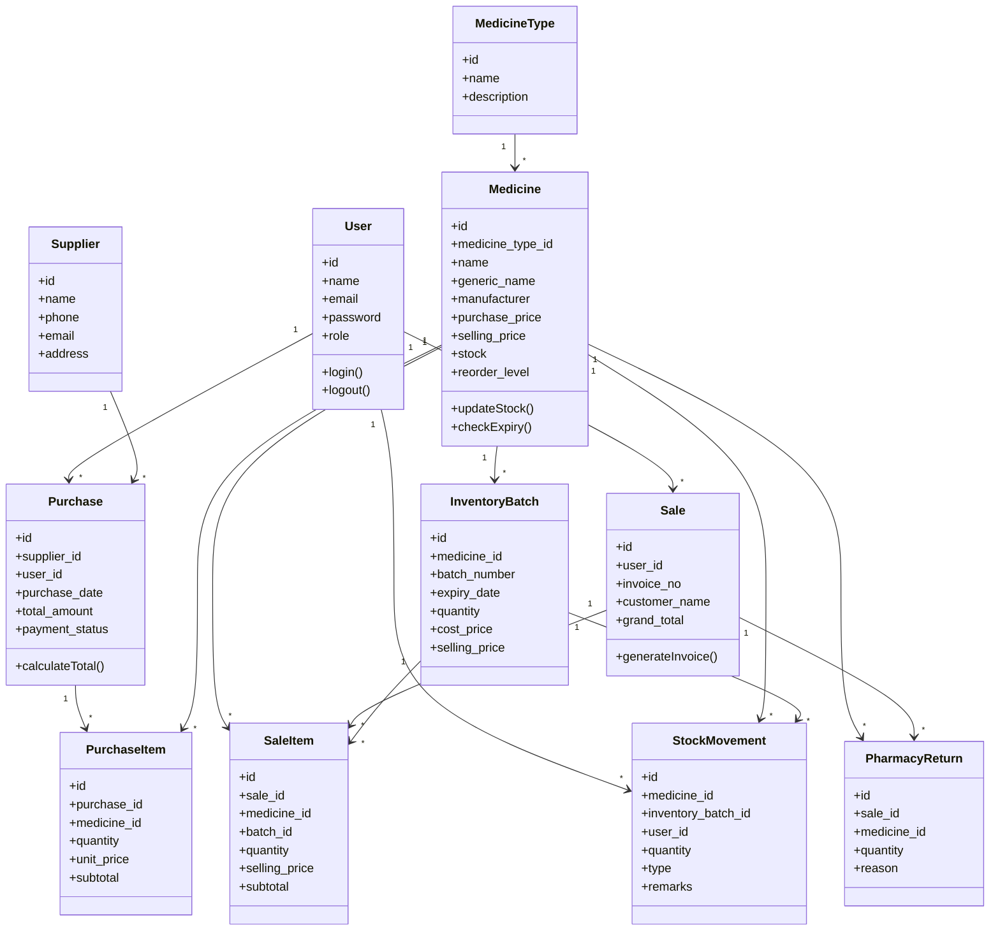

---

# 🧩 Domain Model Description

## 👤 User

The **User** model represents authenticated users of the system.

### Responsibilities

- Login
- Logout
- Authorization
- Purchase creation
- Sales processing
- Inventory updates

### Relationships

```
User

├── Purchases
├── Sales
└── Stock Movements
```

---

## 💊 Medicine

The Medicine model is the core entity of the system.

It stores

- Medicine Name
- Generic Name
- Manufacturer
- Prices
- Stock
- Reorder Level

### Responsibilities

- Maintain medicine information
- Update inventory
- Stock validation
- Expiry checking

### Relationships

```
Medicine

├── Purchase Items
├── Sale Items
├── Inventory Batches
├── Stock Movements
└── Pharmacy Returns
```

---

## 📦 Purchase

Represents medicine procurement from suppliers.

Responsibilities include

- Purchase creation
- Supplier linkage
- Total calculation
- Inventory increment

Relationship

```
Purchase

│

├── Supplier

└── Purchase Items
```

---

## 🧾 Sale

Represents customer billing.

Stores

- Invoice
- Customer Information
- Discount
- Tax
- Payment

Responsibilities

- Generate invoice
- Calculate bill
- Reduce stock
- Record transaction

---

## 📚 Inventory Batch

Each purchase creates inventory batches.

Each batch contains

- Batch Number
- Expiry Date
- Purchase Cost
- Selling Price
- Quantity

Inventory batches make FIFO/FEFO inventory possible.

---

## 📈 Stock Movement

Every inventory change is recorded.

Movement Types

- Purchase
- Sale
- Adjustment
- Return

This creates a complete audit trail.

---

# 🏗 Laravel MVC Architecture

The project follows the standard Laravel MVC design pattern.

```text
                Client

                  │

                  ▼

            web.php Routes

                  │

                  ▼

             Controller

                  │

        Business Logic

                  │

                  ▼

          Eloquent Model

                  │

                  ▼

             MySQL DB

                  │

                  ▼

          Controller

                  │

                  ▼

          Blade Template

                  │

                  ▼

             Browser
```

---

# 📂 MVC Responsibilities

## Model Layer

Responsible for

- Database operations
- Business rules
- Relationships
- Data validation
- ORM

Examples

```
User.php

Medicine.php

Supplier.php

Purchase.php

Sale.php

InventoryBatch.php
```

---

## View Layer

Responsible for

- Dashboard
- Forms
- Tables
- Reports
- Invoices

Laravel Blade templates provide dynamic rendering.

---

## Controller Layer

Responsible for

- Request handling
- Validation
- Authentication
- CRUD operations
- Business workflow

Typical controllers include

```
MedicineController

PurchaseController

SaleController

SupplierController

DashboardController

UserController
```

---

# 🔄 Model Interaction

The following illustrates how the major models interact during a sales transaction.

```text
User

 │

 ▼

Sale

 │

 ▼

Sale Item

 │

 ▼

Inventory Batch

 │

 ▼

Medicine

 │

 ▼

Stock Movement
```

---

# 🏛 Package Dependency Overview

```text
Application

├── Authentication Module

├── Medicine Module

├── Purchase Module

├── Sales Module

├── Inventory Module

├── Supplier Module

├── Reporting Module

└── Settings Module
```

Each module communicates with the database through Laravel Eloquent models and exposes functionality through dedicated controllers.

---

# 🎯 Design Principles Followed

The Pharmacy Management System follows several software engineering principles:

- MVC (Model–View–Controller)
- Separation of Concerns (SoC)
- Single Responsibility Principle (SRP)
- Reusability
- Encapsulation
- Modular Design
- Low Coupling
- High Cohesion
- RESTful Routing
- Object-Oriented Programming (OOP)

These principles make the application easier to maintain, test, and extend.

---

---

# 🎭 Use Case Diagram

The Pharmacy Management System supports three primary user roles:

- **Administrator**
- **Manager**
- **Cashier**

Each role has different responsibilities and permissions within the application.

---

## 👥 Actors

| Actor | Responsibilities |
|--------|------------------|
| Administrator | Full system management |
| Manager | Inventory, Purchases, Suppliers, Reports |
| Cashier | Sales, Billing, Customer Service |

---

## 🎯 Use Case Diagram

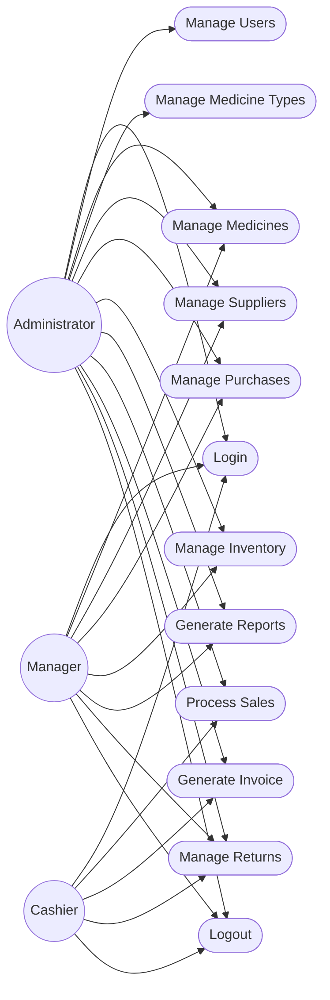

---

# 📋 Use Case Description

## Administrator

The Administrator has complete control over the Pharmacy Management System.

### Responsibilities

- Login
- Manage Users
- Manage Medicines
- Manage Medicine Types
- Manage Suppliers
- Manage Purchases
- Manage Inventory
- Generate Reports
- Process Sales
- Generate Invoices
- Process Returns
- Logout

---

## Manager

The Manager performs operational tasks related to inventory and purchasing.

### Responsibilities

- Login
- Medicine Management
- Supplier Management
- Purchase Management
- Inventory Monitoring
- Reports
- Returns
- Logout

---

## Cashier

The Cashier mainly handles customer transactions.

### Responsibilities

- Login
- Sales
- Invoice Generation
- Returns
- Logout

---

# 🧩 Component Diagram

The Pharmacy Management System consists of several interconnected software components.

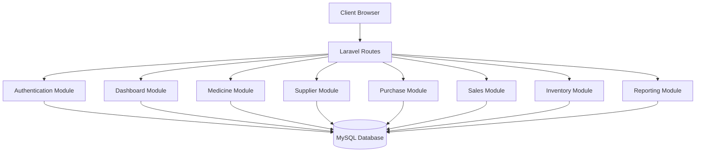

---

# 📦 Component Description

## Authentication Component

Responsible for

- Login
- Logout
- Password Verification
- Session Management
- Authorization
- Role Middleware

---

## Dashboard Component

Provides

- Summary Cards
- Statistics
- Quick Navigation
- Recent Sales
- Low Stock Alerts

---

## Medicine Component

Responsible for

- CRUD Operations
- Medicine Categories
- Stock Information
- Search
- Barcode Support

---

## Supplier Component

Responsible for

- Supplier Registration
- Contact Details
- Purchase History

---

## Purchase Component

Responsible for

- Purchase Orders
- Purchase Items
- Inventory Update
- Supplier Integration

---

## Sales Component

Responsible for

- Billing
- Invoice Generation
- Discounts
- Tax Calculation
- Payment

---

## Inventory Component

Responsible for

- Stock Management
- Batch Tracking
- Expiry Monitoring
- Stock Adjustment
- Low Stock Alert

---

## Reporting Component

Responsible for

- Daily Sales
- Monthly Sales
- Purchase Reports
- Inventory Reports
- Profit Reports

---

# 🔄 Activity Diagram — User Login

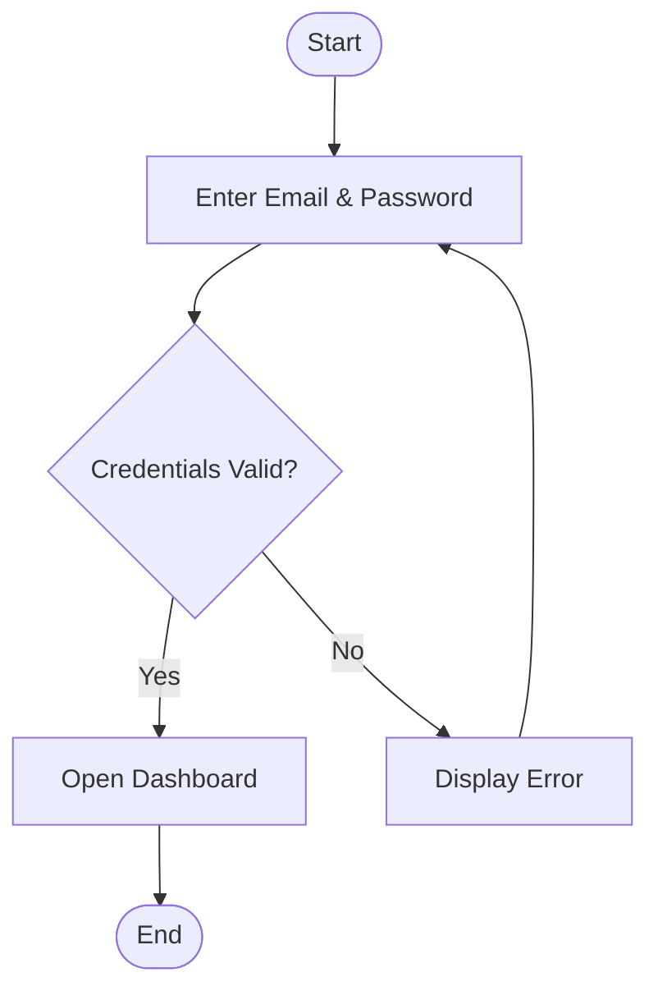

---

# 🔄 Activity Diagram — Purchase Process

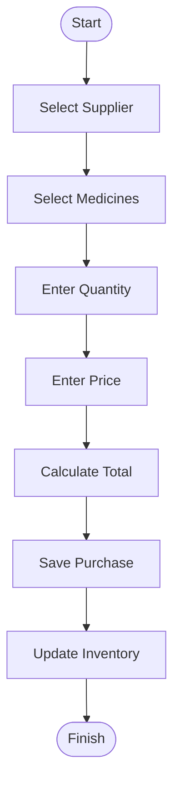

---

# 🔄 Activity Diagram — Sales Process

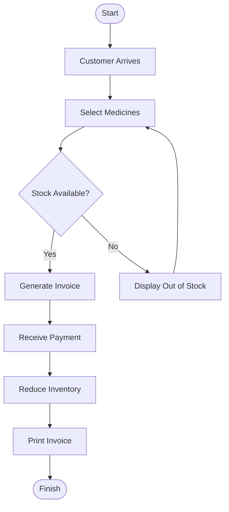

---

# 🔄 Activity Diagram — Inventory Update

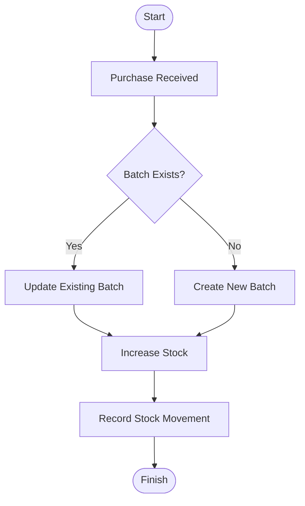

---

# 📊 Component Interaction Overview

```text
Browser
    │
    ▼
Laravel Router
    │
    ▼
Controllers
    │
    ├─────────────┐
    ▼             ▼
Models         Blade Views
    │
    ▼
MySQL Database
```

---

# 🔗 Module Interaction

```text
Authentication
      │
      ▼
Dashboard
      │
      ▼
Medicine Module
      │
      ▼
Purchase Module
      │
      ▼
Inventory Module
      │
      ▼
Sales Module
      │
      ▼
Reporting Module
```

---

# 🏗 Overall Component Workflow

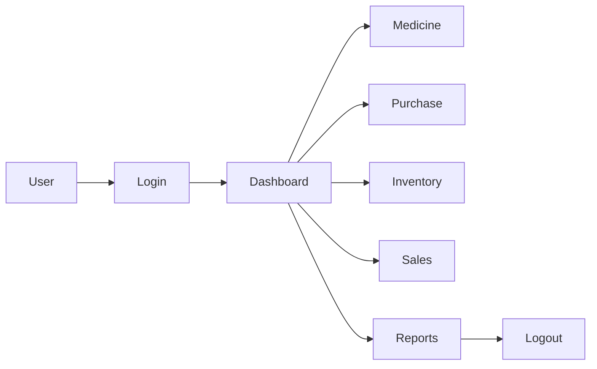

---
---

# 🔄 Sequence Diagrams

Sequence diagrams illustrate how different components of the Pharmacy Management System communicate during various operations. These diagrams demonstrate the interaction between the **User**, **Browser**, **Laravel Application**, **Controllers**, **Models**, and **Database**.

---

# 🔐 Sequence Diagram – User Login

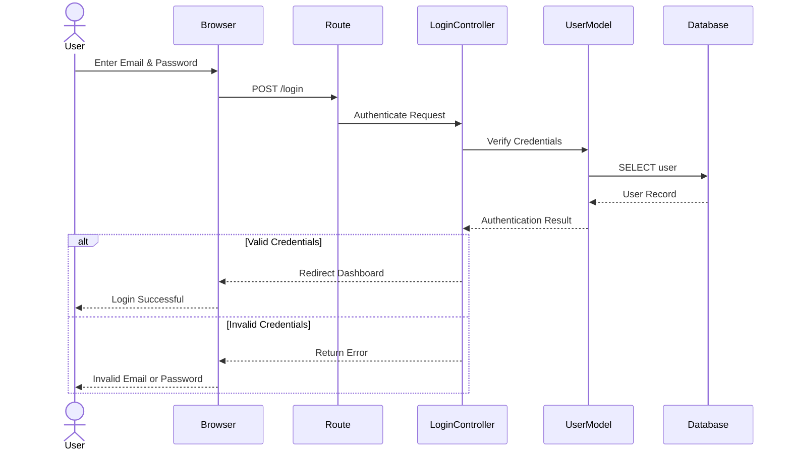

---

# 🛒 Sequence Diagram – Purchase Process

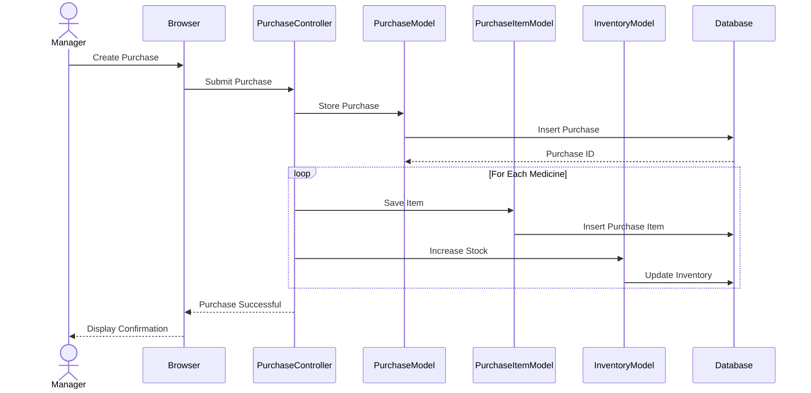

---

# 💰 Sequence Diagram – Sales Process

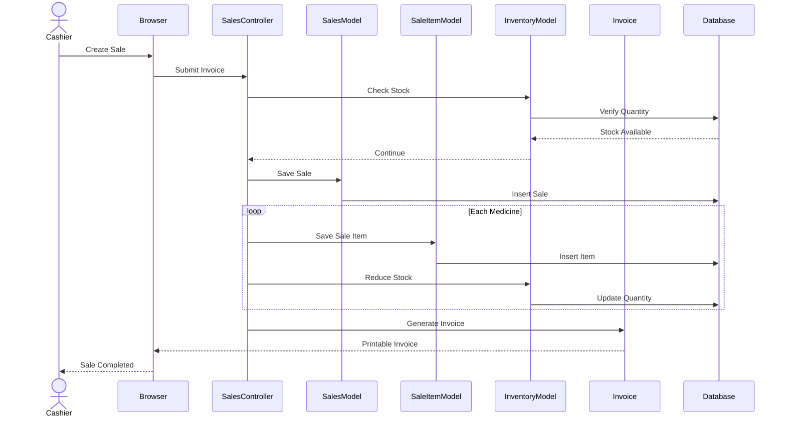

---

# 📦 Sequence Diagram – Inventory Update

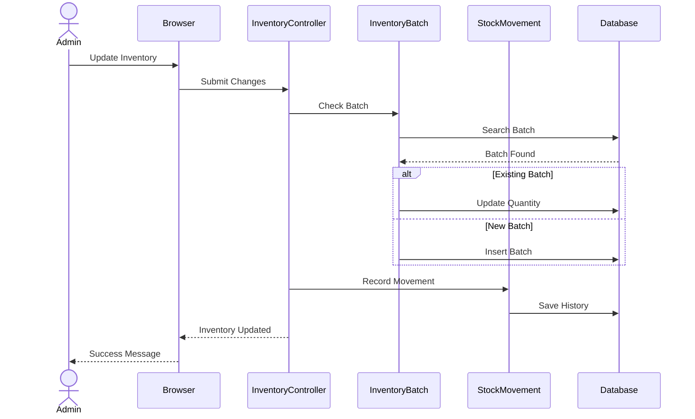

---

# 🧾 Sequence Diagram – Invoice Generation

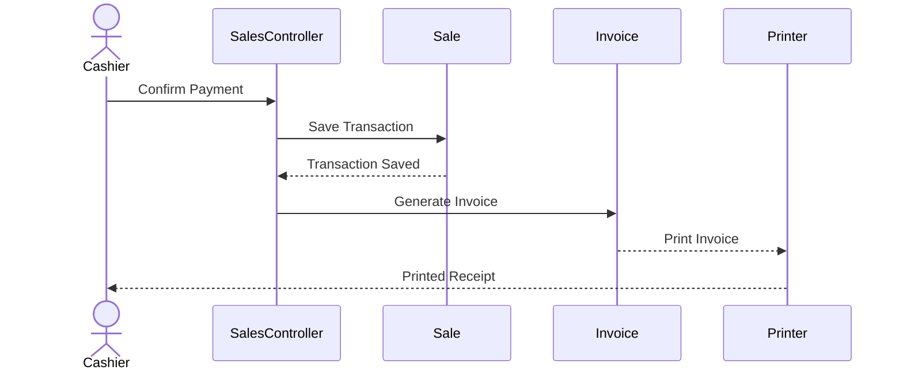

---

# 🌊 Flow Diagram – Overall System Workflow

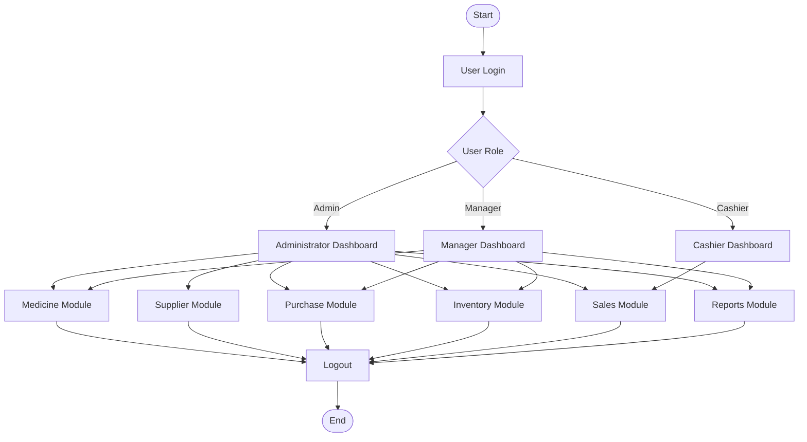

---

# 💊 Flow Diagram – Medicine Management

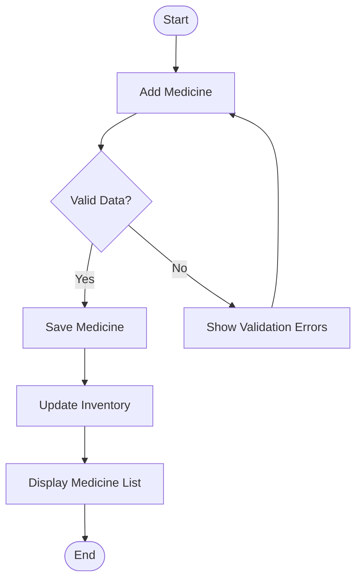

---

# 📦 Flow Diagram – Inventory Management

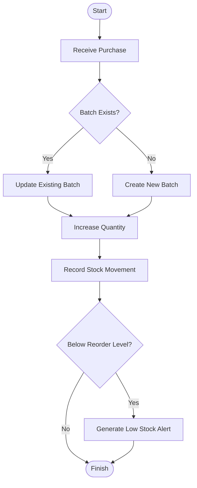

---

# 🛒 Flow Diagram – Sales & Billing

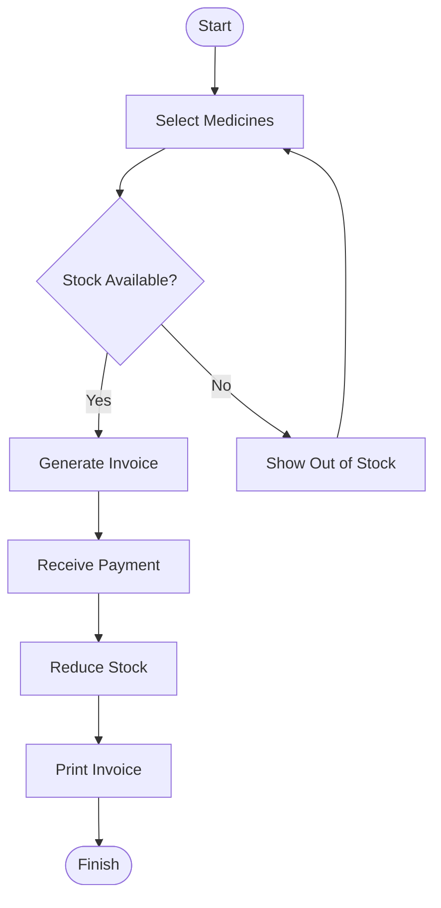

---

# 🔄 End-to-End Business Process

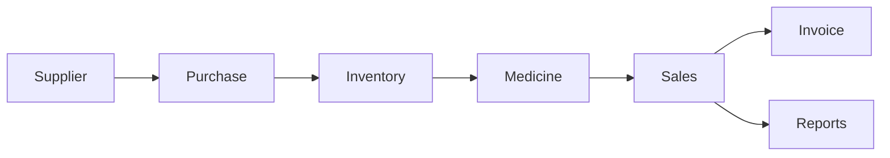

---

# 🏗 Complete Application Workflow

```text
                User
                  │
                  ▼
             Login Page
                  │
                  ▼
        Authentication Module
                  │
                  ▼
        Role-Based Authorization
                  │
        ┌─────────┼──────────┐
        ▼         ▼          ▼
     Admin     Manager    Cashier
        │         │          │
        ├─────────┼──────────┤
                  ▼
            Dashboard
                  │
      ┌───────────┼────────────┐
      ▼           ▼            ▼
 Medicines   Purchases     Suppliers
      │           │            │
      └───────────┼────────────┘
                  ▼
             Inventory
                  │
                  ▼
               Sales
                  │
                  ▼
              Invoice
                  │
                  ▼
              Reporting
                  │
                  ▼
               Logout
```

---

# 📌 Diagram Summary

| Diagram | Purpose |
|----------|---------|
| Login Sequence Diagram | Shows authentication workflow |
| Purchase Sequence Diagram | Explains medicine procurement process |
| Sales Sequence Diagram | Illustrates billing and inventory deduction |
| Inventory Sequence Diagram | Demonstrates stock update and audit logging |
| Invoice Generation Diagram | Shows invoice creation and printing |
| System Workflow Diagram | High-level application flow |
| Medicine Management Flow | CRUD lifecycle for medicines |
| Inventory Management Flow | Batch and stock management process |
| Sales & Billing Flow | Complete billing workflow |
| End-to-End Business Process | Overall operational lifecycle |

---
